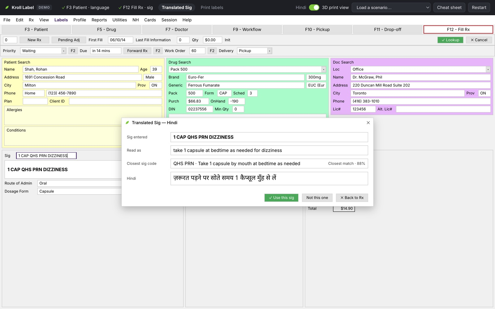
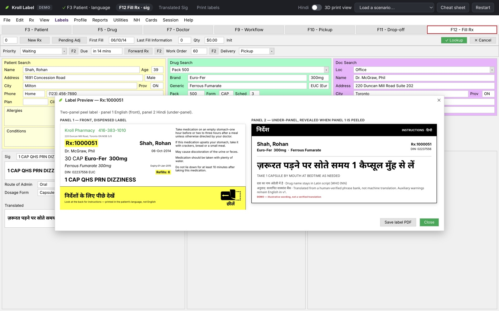

# Kroll Label — translated prescription labels for TELUS Health Kroll

A clickable demo of the **GBDA 402 capstone** concept for TELUS Health **Kroll**. The pharmacist records the patient's language, fills an Rx, and confirms a translated sig. Kroll then prints a **two-panel peel label**: English on the front and the patient's language underneath. A 3D printer prints it onto a pill vial.

It runs on **macOS and Windows**.

> [!IMPORTANT]
> **Demo only. This is not a translation engine.** Every non-English sentence was written by the team, and all of it is illustrative and unverified. The app never composes or machine-translates text; it only picks one of those whole sentences. A real, verified translation platform plugs in at a single interface (see [Translation provider](#translation-provider)).


## Download

Get the latest build from **[Releases](https://github.com/dw2lam/telus-kroll-translation/releases/latest)**:

| Platform | File |
|---|---|
| macOS · Apple Silicon | `Kroll.Label-<version>-mac-arm64.dmg` |
| macOS · Intel | `Kroll.Label-<version>-mac-x64.dmg` |
| Windows · x64 installer | `Kroll.Label-<version>-win-setup-x64.exe` |
| Windows · ARM installer | `Kroll.Label-<version>-win-setup-arm64.exe` |
| Windows · no install | `Kroll.Label-<version>-win-portable.exe` |

The builds are **unsigned**, so each OS will warn you the first time:

- **macOS:** drag *Kroll Label* to Applications, then open it.
  - If macOS says it "can't be opened" or "is damaged", go to *System Settings → Privacy & Security* and click **Open Anyway**.
  - Or run this in Terminal: `xattr -dr com.apple.quarantine "/Applications/Kroll Label.app"`
- **Windows:** SmartScreen shows "Windows protected your PC". Click **More info → Run anyway**.

## The flow

The screens are rebuilt from the team's Figma file *GBDA 402 Capstone*: section **B · New flow — translated sig** and section **C · Labels — printed output**.

| Step | Screen |
|---|---|
| 1. **F3 Patient**: record the patient's language. Languages with verified sigs show *(Translation Available)*. |  |
| 2. **F12 Fill Rx**: type a Kroll sig code (`*1C`, `BID`, `2 QHS`) or free text and press ↵. The **Translated Sig** pop-up shows the matching state. |  |
| 3. Free text that isn't exact goes **Closest → Not this one → Top 5 → None of these → Phrasing guide → None of these fit → Can't translate** (English label only). |  |
| 4. Once confirmed, the translation lands in the Rx and the labels print: a 3D printer feeds both panels onto an amber vial. **Peel panel 1** reveals the patient's language underneath. |  |
| 5. With **3D print view** off, or on request via the **Labels** menu, **Labels F2** or **Ctrl/⌘+L**, the labels open right inside Kroll. **Save label PDF** prints them 4 in wide. |  |

The Translated Sig pop-up has six states:

| State | Figma frame |
|---|---|
| Exact match | B4 |
| Closest match | B7 |
| Top 5 | B8 |
| Phrasing guide | B9 |
| Can't translate | B10 |
| Captured, not yet translatable | B4t |

## Presenter tools

The dark top bar is demo chrome, not part of Kroll.

- **3D print view** switches between the 3D printer → vial view and labels shown inside Kroll. The setting is remembered between launches.
- **Load a scenario…** jumps straight into each branch:
  - Hindi `*1C` and Hindi free text
  - Tagalog
  - Arabic (right-to-left)
  - Chinese (Traditional)
  - Punjabi (Shahmukhi)
- **Cheat sheet** (or **F1**) covers every sig code × patient language, plus free-text examples, the pharmacist moves and the keys. It is computed live from the provider, so it always matches what the app does.
  - **Click any cell** to load that sig into Fill Rx and run it.
  - **Save as PDF** gives you a printable copy.


### Keys

| Key | Does |
|---|---|
| ↵ | Translate the sig |
| F3 / F12 | Patient / Fill Rx (F12 again prints) |
| Ctrl/⌘ + L | Preview labels inside Kroll |
| F1 | Cheat sheet |
| Esc | Close the pop-up |

## Sig codes and languages

**Codes:** QD, BID, TID, QID, QHS, QAM, QPM, Q4H, Q6H, Q8H, Q12H, QHS PRN, QD PRN, QHS PRN SLP, PRN, Q4-6H PRN, AC, PC, CF, QD CF, BID CF, UD.

- Shorthand `*1C` / `1C` = 1 × QD and `*2C` = 2 × QD.
- A leading dose also works, e.g. `2 BID`.

**Languages:**

- **Hindi:** the full flow.
- **Arabic:** QD, BID, QHS, UD (right-to-left).
- **Chinese (Traditional):** QD, BID, QD CF.
- **Punjabi (Shahmukhi):** `*1C`.
- **French, Spanish, Tagalog, Urdu:** recorded on the patient but not yet translatable.

A code with no sentence for the patient's language goes straight to the phrasing guide, which is the correct, safe behaviour. To add a sentence, put it in [`src/renderer/src/data/phrasebook.ts`](src/renderer/src/data/phrasebook.ts). The app and the cheat sheet pick it up.

## Translation provider

[`src/renderer/src/data/types.ts`](src/renderer/src/data/types.ts) defines `TranslationProvider`:

```ts
interface TranslationProvider {
  translate(sig: string, language: Language): TranslationResult   // the pop-up state
  phrasingGuide(language: Language): VerifiedSig[]                 // every verified sig for the language
  render(sig: VerifiedSig, language: Language, dose: string): string | null
}
```

`DemoProvider` picks whole sentences from the phrase bank using a few keywords. Replace it with the verified platform and nothing else in the app changes.

## Develop

Requires Node 22.

```sh
npm install
npm run dev        # Electron with hot reload
npm test           # unit tests (flow + provider)
npm run test:e2e   # drives the built app through every scenario (hidden window)
npm run typecheck
```

### Package

```sh
npm run dist       # macOS + Windows into dist/
npm run dist:mac   # dmg + zip, arm64 + x64
npm run dist:win   # NSIS installers (x64, arm64) + portable exe
```

Both platforms build on a Mac; no Wine is needed. [`.github/workflows/build.yml`](.github/workflows/build.yml) does three things:

- runs the tests;
- builds macOS on `macos-latest` and Windows on `windows-latest`;
- uploads the packages as workflow artifacts.

## Project layout

```
src/main/        Electron main: window, menu, offscreen label rendering, PDF export
src/preload/     window.kroll bridge (context-isolated, sandboxed)
src/renderer/    React app
  flow/          F3 Patient, F12 Fill Rx, Translated Sig pop-up, label preview, flow state
  labels/        panel 1 / panel 2 label layouts + the offscreen render page
  print/         Print view + the three.js printer → vial scene
  cheatsheet/    the live cheat sheet
  data/          languages, phrase bank, demo provider, demo Rx
build/           app icon
tests/           vitest unit tests + Playwright end-to-end
```

The app icon combines the TELUS mark, taken from the official TELUS Health logo, with the *Kroll* name. Kroll and TELUS Health are trademarks of TELUS. This is a student capstone demo, not a TELUS product.

MIT © 2026 David Lam
