# Telus Kroll Translation Demo — translated prescription labels for TELUS Health Kroll

A clickable demo of the **GBDA 402 capstone** concept for TELUS Health **Kroll**. The pharmacist records the patient's language, fills an Rx, and confirms a translated sig. Kroll then prints a **two-panel peel label**: English on the front and the patient's language underneath. A 3D printer prints it onto a pill vial.

It also covers what happens when things go wrong: a language that isn't supported yet, a sig with no verified sentence, a translation reported as wrong before or after printing, a sentence paused for every pharmacy, and the audit log that proves what printed.

It runs on **macOS and Windows**.

> [!IMPORTANT]
> **Demo only. This is not a translation engine.** Every non-English sentence was written by the team, and all of it is illustrative and unverified. The app never composes or machine-translates text; it only picks one of those whole sentences. A real, verified translation platform plugs in at a single interface (see [Translation provider](#translation-provider)).

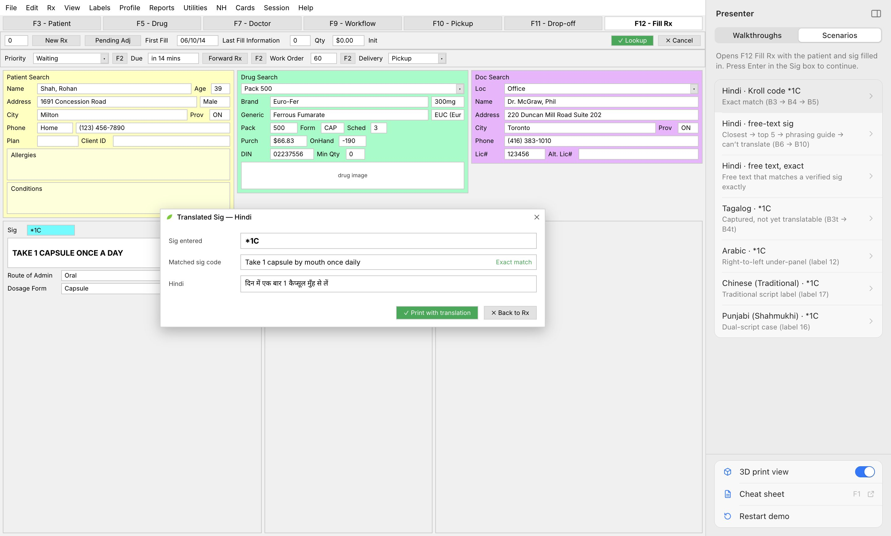

## Download

Get the latest build from **[Releases](https://github.com/dw2lam/telus-kroll-translation/releases/latest)**:

| Platform | File |
|---|---|
| macOS · Apple Silicon | `Telus-Kroll-Translation-Demo-<version>-mac-arm64.dmg` |
| Windows · x64 (installer) | `Telus-Kroll-Translation-Demo-<version>-win-setup-x64.exe` |
| Windows · x64 (portable, no install) | `Telus-Kroll-Translation-Demo-<version>-win-portable-x64.exe` |

The builds are **unsigned**, so each OS will warn you the first time:

- **macOS:** drag *Telus Kroll Translation Demo* to Applications, then open it.
  - If macOS says it "can't be opened" or "is damaged", go to *System Settings → Privacy & Security* and click **Open Anyway**.
  - Or run this in Terminal: `xattr -dr com.apple.quarantine "/Applications/Telus Kroll Translation Demo.app"`
- **Windows:** SmartScreen shows "Windows protected your PC". Click **More info → Run anyway**.

### Auto-updates

The installed app checks this repo's Releases on launch, every 4 hours, and from **Help → Check for Updates…**.

When a newer release is out, the app downloads it in the background, checks it against the SHA-256 GitHub lists for the file, and asks to restart. **Restart Now** updates straight away; **Later** updates the next time you quit.

- **macOS:** the new app is copied out of the `.dmg` beside the installed one and swapped in after the app exits. This needs no Apple signing. A copy running from the mounted `.dmg` or another read-only place can't replace itself, so it offers the `.dmg` instead; drag it to Applications once and it updates itself from then on.
- **Windows installer:** the setup runs silently once the app has closed.
- **Windows portable:** it can't replace itself, so it offers **Download** and shows the new exe in Downloads; run it instead of the old one.

Releases hold only the installers, no update feeds: the app reads the latest release's tag from the GitHub API and picks its file by name. The repo is public, so no token is needed.

## The flow

The screens are rebuilt from the team's Figma file *GBDA 402 Capstone*: section **B · New flow — translated sig** and section **C · Labels — printed output**.

| Step | Screen |
|---|---|
The demo patient is **Ms. Mei Leung**, the team's primary persona: 74, Markham, reads Chinese (Simplified). **Mrs. Parvin Farahani**, mother of the secondary persona Sara Farahani, reads Persian, which isn't translatable at rollout.

| Step | Screen |
|---|---|
| 1. **F3 Patient**: record the patient's language. Languages with verified sigs show *(Translation Available)*. | 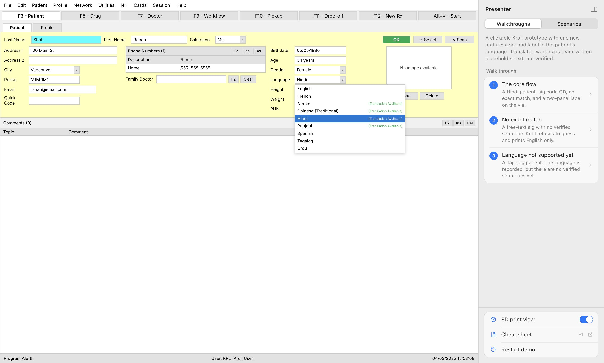 |
| 2. **F12 Fill Rx**: type a sig code (`DAILY`, `1C PO BID`, `2 CAP PO QHS`) or free text and press ↵. The **Translated Sig** pop-up shows the verified sentence and where it came from. The pharmacist confirms the English; the translation's accuracy is the verified library's. |  |
| 3. Free text that isn't exact goes **Closest → Not this one → Top 5 → None of these → Phrasing guide → None of these fit → Can't translate**: English label only, with a translation request logged. | 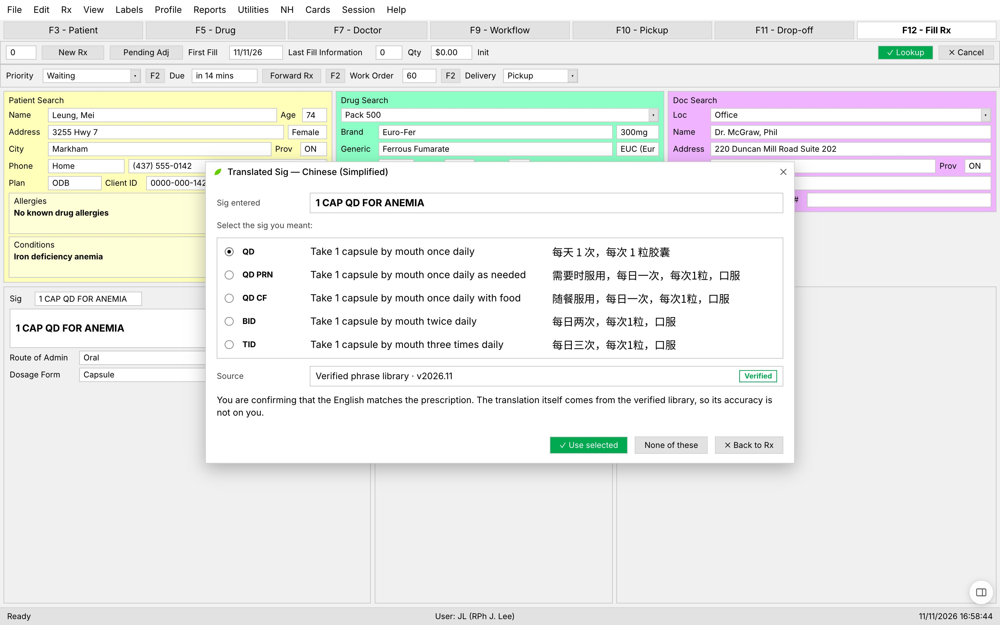 |
| 4. **Preview labels** before printing, or print straight away: a 3D printer feeds both panels onto an amber vial, and **Peel panel 1** reveals the patient's language underneath. Each translated label carries a **trace code**. | 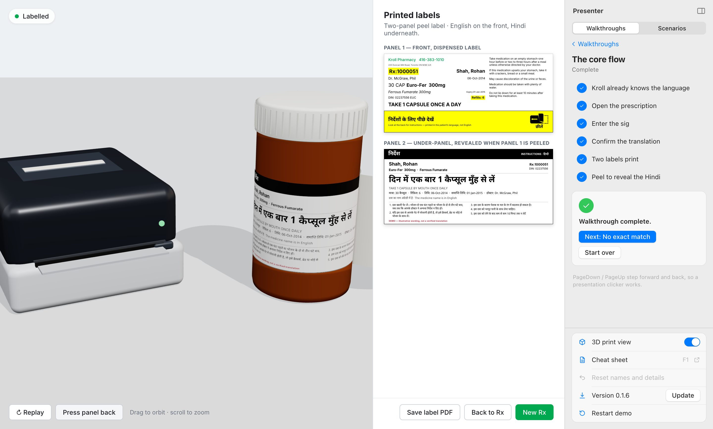 |
| 5. With **3D print view** off, or via the **Labels** menu, **Labels F2** or **Ctrl/⌘+L**, the labels open inside Kroll with the **translation record** saved to the Rx history. **Save label PDF** prints them 4 in wide. | 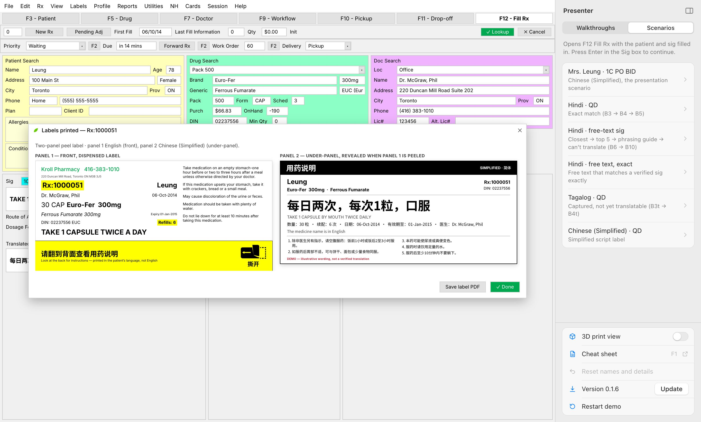 |

The Translated Sig pop-up has seven states:

| State | Figma frame |
|---|---|
| Exact match | B4 |
| Closest match | B7 |
| Top 5 | B8 |
| Phrasing guide | B9 |
| Can't translate | B10 |
| Captured, not yet translatable | B4t |
| Paused (a severity 1 report is being re-reviewed) | E6 |

## Edge cases: reporting and the audit log

Two PRDs drive the error cases. Everything works in free play as well as in the guided scenarios.

**Reporting a translation issue.** Report from the label preview before printing, from a printed label, from **Rx → Rx History**, or with **Utilities → Report a translation issue…** when a patient calls and reads out the Rx number.

- The pharmacist picks the faulty line by its **standard English**, never a phrase ID, and says what's wrong, who noticed, and whether the medication was taken.
- **Severity is computed, not chosen:** changes the meaning or missing information is 1, unreadable or unclear is 2, formatting only is 3, and a wrong English phrase is a pharmacy error that pauses nothing.
- **Before printing:** the flagged line prints in English with a "could not be translated" note. If it's the dosing directions, no translated label prints at all.
- **After printing:** a corrected or English-only reprint, a prompt to contact the patient if the medication was taken, and the AIMS incident-reporting reminder.
- **Severity 1 pauses the sentence for every pharmacy.** Each pharmacy gets a callback list built from its own log; TELUS never sees it.

| | |
|---|---|
| 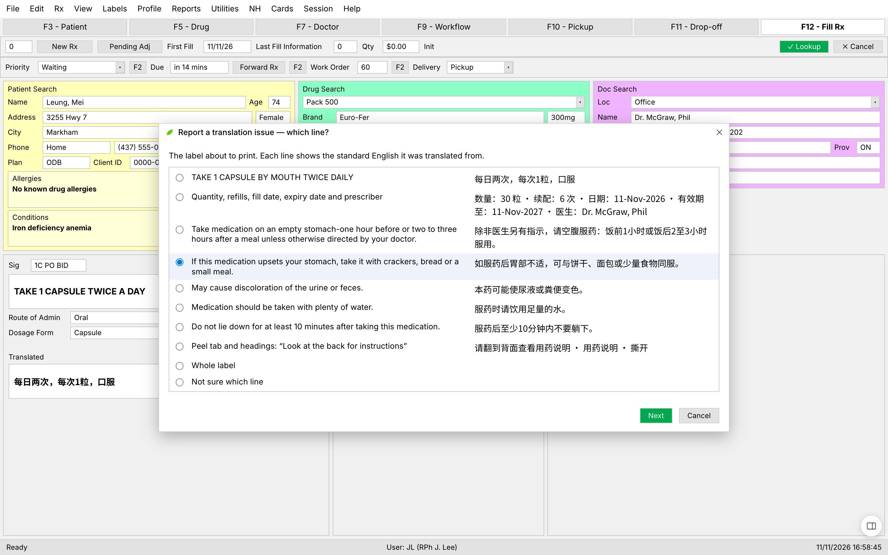 | 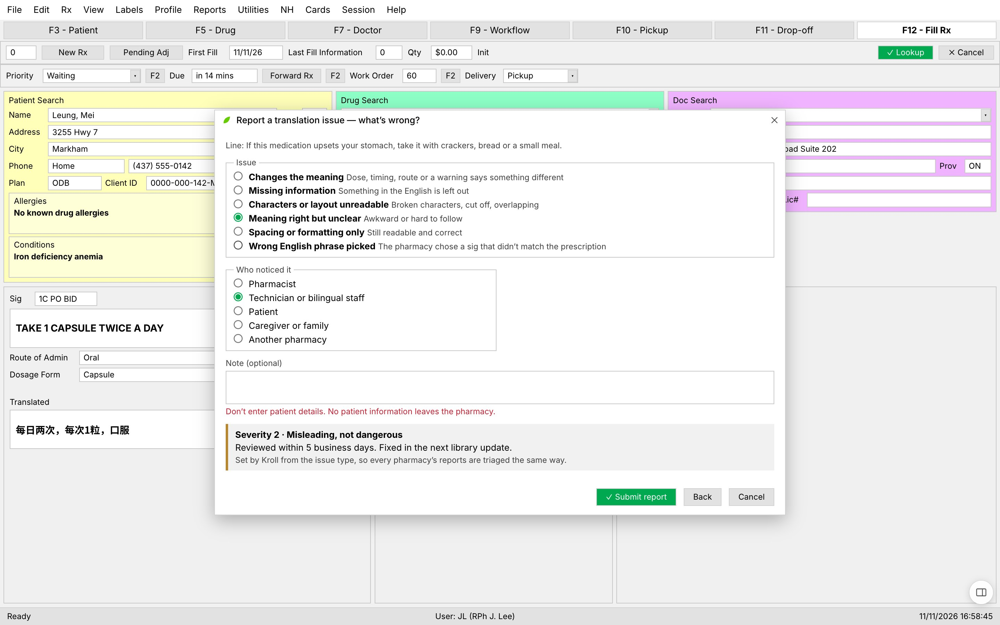 |
| 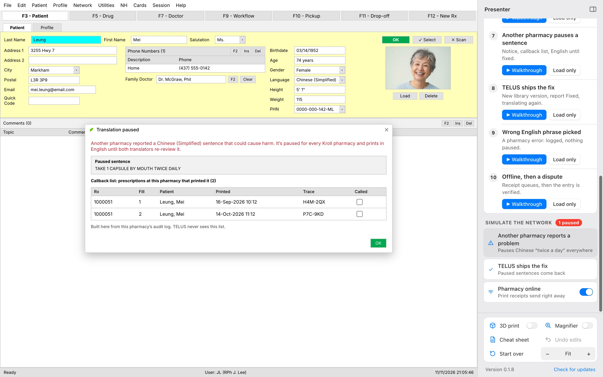 | 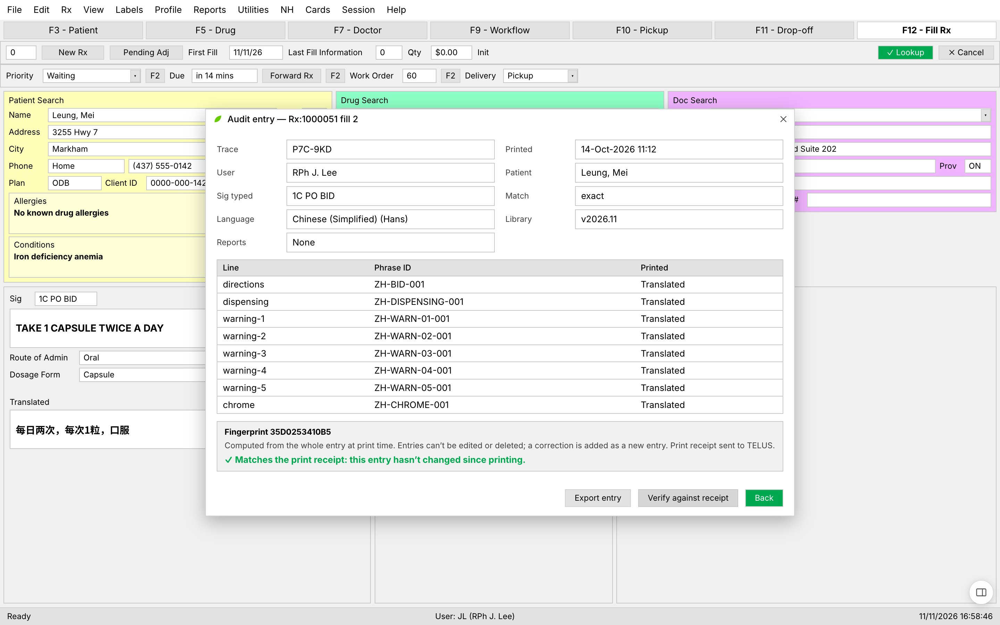 |

**Audit log.** Every print is logged in the pharmacy's Kroll with a random trace code, the phrases and library version used, who confirmed it, and a **fingerprint**. Entries are never edited; a correction is a new entry. Each translated print sends TELUS a **print receipt** with no patient information, queued while the pharmacy is offline. In a dispute, **Rx History → View entry** verifies the entry against its receipt and exports it as JSON.

## Presenter tools

Presenter controls live in a sidebar on the right. None of it is part of Kroll. Hide it with the sidebar button or **Ctrl/⌘ + ,**; bring it back with the round button in the corner, the same shortcut, or **Demo → Show or Hide Presenter**.

- **Scenarios:** the main demo and nine edge cases. **▶ Walkthrough** takes you through one step at a time, with notes, and rings the control each step is about; do the step from the sidebar or in Kroll yourself. **Load only** fills Kroll in for that scenario and leaves the clicking to you. **PageDown / PageUp** step forward and back, so a presentation clicker works.
  1. Basic: sig code → labels (Ms. Leung, `1C PO BID`)
  2. Language not supported yet (Mrs. Farahani, Persian)
  3. No verified sentence fits (`1 CAP DAILY FOR ANEMIA`)
  4. Technician flags a line before printing
  5. Dosing directions flagged
  6. Family calls days later (Rx 1000048)
  7. Another pharmacy pauses a sentence
  8. TELUS ships the fix
  9. Wrong English phrase picked
  10. Offline, then a dispute
- **Simulate the network:** another pharmacy reports a problem, TELUS ships the fix, and the pharmacy going offline.
- **Controls:** 3D print view, Magnifier (zooms around the pointer, **⇧⌘M**), Cheat sheet, Undo edits, Start over, and Kroll size (**⌘+ / ⌘− / ⌘0**).
- **Cheat sheet** (or **F1**) opens in its own window, in three tabs. **Learn sig codes** is a short lesson (what a sig is, reading one left to right, the Latin pieces, how codes stack, why codes translate exactly, what to watch out for) with a live **sig decoder** beside it that breaks any sig into its pieces and shows both label panels, and a practice quiz. **Code reference** lists every code with its meaning, its Latin, the English Kroll prints and the Chinese and Hindi. **Demo guide** has each pop-up state with a live example, how to reach every edge case, the reporting tools and the keys. Search filters the codes; a phrase with no code can be tried as free text. Click anything to run it in Kroll; **Save as PDF** for a printable copy.

| | |
|---|---|
| 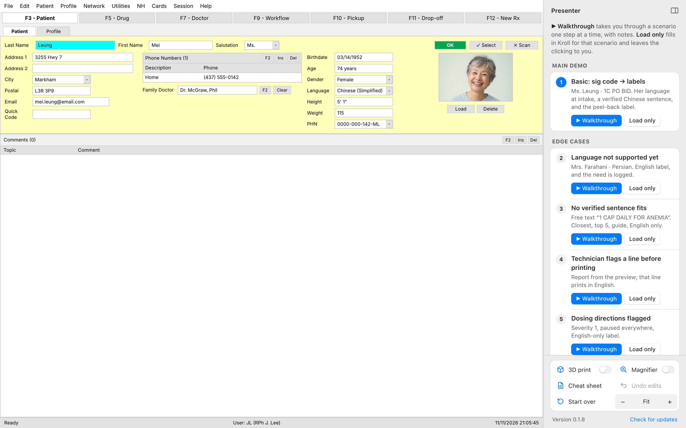 | 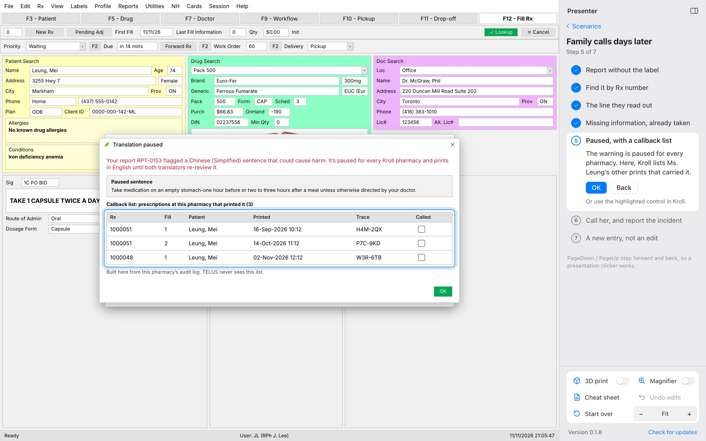 |

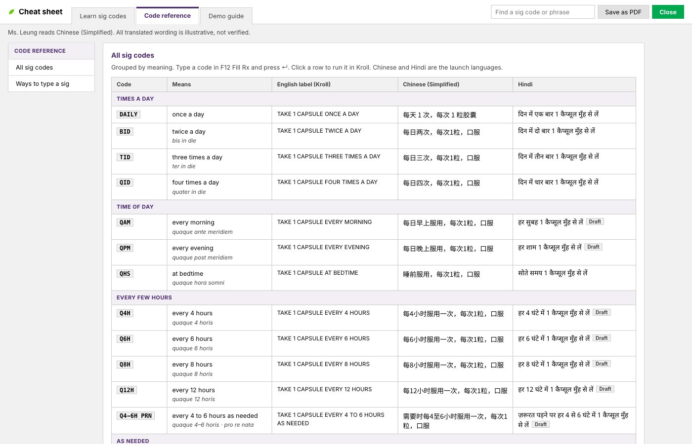

### Keys

| Key | Does |
|---|---|
| ↵ | Translate the sig |
| F3 / F12 | Patient / Fill Rx (F12 again prints) |
| Ctrl/⌘ + L | Preview labels inside Kroll |
| F1 | Cheat sheet |
| Ctrl/⌘ + , | Show or hide the presenter sidebar |
| PageDown / PageUp | Next / previous walkthrough step |
| ⇧⌘M (Ctrl+Shift+M) | Magnifier |
| Ctrl/⌘ + / − / 0 | Kroll size |
| Esc | Close the pop-up or cheat sheet |

## Editing on screen

Patient, doctor, drug, quantity and refill fields on F3 Patient and F12 Fill Rx can be typed into, and what you type prints on the labels. **Undo edits** in the sidebar puts them back. Patient details are demo values; phone numbers are fictional (555-01xx) and health card numbers are obviously fake.

## Sig codes and languages

**Codes:** DAILY, BID, TID, QID, QHS, QAM, QPM, Q4H, Q6H, Q8H, Q12H, QHS PRN, DAILY PRN, QHS PRN SLP, PRN, Q4-6H PRN, AC, PC, CF, DAILY CF, BID CF, UD.

- A dose can lead the code, written short or in full: `2 BID`, `1C PO BID`, `1T PO BID`, `2 CAP PO BID`. `T` swaps capsule for tablet on the sig and the label.
- `HS` reads as QHS. There is no `QD` or `OD`: both are on [ISMP Canada's Do Not Use list](https://www.ismp-canada.org/download/ISMPC_List_of_Dangerous_Abbreviations.pdf), which says to use “daily”. The Figma frames' shorthand also works: `*1C` / `1C` = 1 × DAILY, `*2C` = 2 × DAILY.

**Languages:**

- **Chinese (Simplified):** every code above. Three are the team's wording; the rest (`CHINESE_LIBRARY` in the phrasebook) were written in the same style and still need a certified translator's review.
- **Hindi:** every code above; sentences the team didn't write are in `DRAFTS` and marked **Draft** on the cheat sheet. Only the exact code reaches a draft; free text never does.
- **French, Arabic, Chinese (Traditional), Persian (Farsi), Punjabi, Spanish, Tagalog, Urdu:** recorded on the patient but not yet translatable. A code with no sentence for the patient's language or dose goes straight to the phrasing guide, which is the correct, safe behaviour. To add a sentence, put it in [`src/renderer/src/data/phrasebook.ts`](src/renderer/src/data/phrasebook.ts). The app and the cheat sheet pick it up.

## Translation provider

[`src/renderer/src/data/types.ts`](src/renderer/src/data/types.ts) defines `TranslationProvider`:

```ts
interface TranslationProvider {
  translate(sig: string, language: Language): TranslationResult   // the pop-up state
  phrasingGuide(language: Language): VerifiedSig[]                 // every verified sig for the language
  render(sig: VerifiedSig, language: Language, dose: string): string | null
}
```

`DemoProvider` picks whole sentences from the phrase bank using a few keywords. Replace it with the verified platform and nothing else in the app changes.

## Develop

Requires Node 22.

```sh
npm install
npm run dev        # Electron with hot reload
npm test           # unit tests (flow + provider)
npm run test:e2e   # drives the built app through every scenario (hidden window)
npm run typecheck
```

### Package

```sh
npm run dist       # macOS + Windows into dist/
npm run dist:mac   # Apple Silicon dmg
npm run dist:win   # Windows x64 installer + portable exe
```

Both platforms build on a Mac; no Wine is needed.

### Release (with auto-update)

1. Bump `version` in `package.json` (e.g. `0.1.8`), recapture the README screenshots, and commit.
2. Push `main` to this repo.
3. Run `npm run release`. It tests and builds both platforms, then creates the `v<version>` GitHub release with just the three files: the Mac dmg, the Windows installer and the Windows portable exe. It uses your `gh` login. [`.github/workflows/build.yml`](.github/workflows/build.yml) does three things:

- runs the tests;
- builds macOS on `macos-latest` and Windows on `windows-latest`;
- uploads the packages as workflow artifacts.

## Project layout

```
src/main/        Electron main: window, menu, offscreen label rendering, PDF export
src/preload/     window.kroll bridge (context-isolated, sandboxed)
src/renderer/    React app
  flow/          F3 Patient, F12 Fill Rx, Translated Sig pop-up, label preview, flow state
  labels/        panel 1 / panel 2 label layouts + the offscreen render page
  print/         Print view + the three.js printer → vial scene
  cheatsheet/    the live cheat sheet
  demo/          presenter sidebar, walkthrough steps, focus ring
  data/          languages, phrase bank, demo provider, demo Rx, audit log + seeded history
build/           app icon
tests/           vitest unit tests + Playwright end-to-end
```

The app icon combines the TELUS mark, taken from the official TELUS Health logo, with the *Kroll* name. Kroll and TELUS Health are trademarks of TELUS. This is a student capstone demo, not a TELUS product.

MIT © 2026 David Lam
